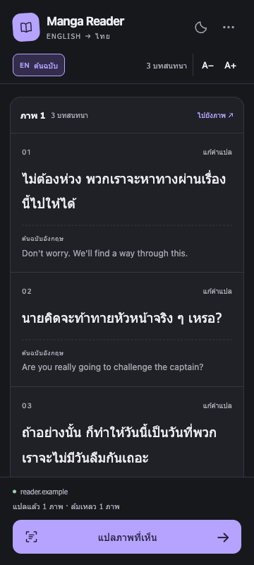
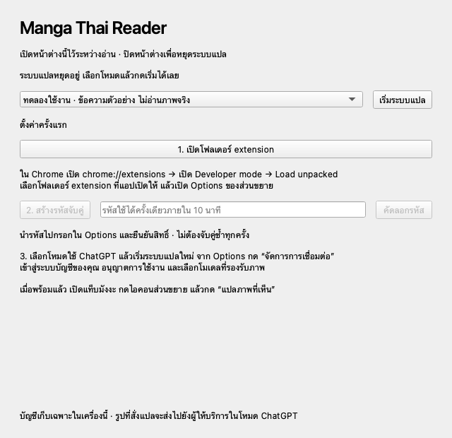

# Manga Thai Reader

**English manga dialogue → Thai, beside the original page.**

[](https://github.com/LiiWzz/Manga-Translator/actions/workflows/ci.yml)
[Desktop builds](https://github.com/LiiWzz/Manga-Translator/actions/workflows/desktop.yml) · [Setup](#quick-start) · [Reader guide](docs/READER_V04.md) · [Roadmap](docs/POC_PLAN.md)

A Chrome extension with a local companion that translates manga into a Thai reading panel. The current **v0.4 Reader** uses a vision model to read dialogue while preserving the original image. Run the companion on Windows or macOS, or use Docker for development. Connect your own eligible ChatGPT account for real translation; the default mock mode provides generated demo text without provider calls.

**Status:** The Reader, persistent cache, Settings, model controls and desktop companion are included in `main`. Live Reader inference has been exercised, and the reliability baseline has user-reported Chrome acceptance. This remains a local, single-user POC: desktop bundles are unsigned test builds, and clean-machine installation, broader account flows and newer Reader/Settings features still have acceptance work pending.



*Reader layout preview with generated dialogue. See [panel design](docs/READER_PANEL_DESIGN.md) for more views.*

## What you can do

| Feature | Behavior |
| --- | --- |
| Read beside the page | Thai-first Chrome Side Panel, optional English, adjustable text size and light/dark appearance. Original image pixels stay untouched. |
| Translate on demand | Process up to three eligible, visible images per click. Tall strips use bounded overlapping crops to retain detail. |
| Read across site layouts | Approve image/CDN access one origin at a time, or capture the visible page and confirm a selected area for canvas, background images and embedded readers. |
| Keep translations and corrections | Save dialogue and your edits in the Chrome profile. Matching results are reused after image, settings and context checks. |
| Choose the next model | Load your account's model choices directly in Reader. Changing selection preserves displayed dialogue and edits; each result keeps its original model label. |
| Recover from failures | Persistent per-image errors and explicit retries, with guidance for pairing, reconnecting, model support and usage limits. |
| Run without Docker | The Windows/macOS companion starts the local gateway, exports the extension and generates a pairing code. |

## Quick start

Use desktop Chrome and images you have permission to access and translate. Real translation also requires an eligible account, explicit ChatGPT plan-use consent, an available vision-capable model and remaining usage allowance.

| Setup | You need | Extension folder |
| --- | --- | --- |
| Desktop companion | Chrome + a Windows x64, Mac Apple Silicon or Mac Intel test bundle. Current Mac bundles require macOS 14+. | The stable folder opened by the companion. |
| Docker/source | Chrome + Git + Docker Desktop/Engine with Compose. | `apps/extension` in your checkout. |

### Option A: desktop companion

1. Open [Desktop companion builds](https://github.com/LiiWzz/Manga-Translator/actions/workflows/desktop.yml), select a successful run with artifacts, and download the artifact for your OS/architecture. It contains an app ZIP, a SHA-256 file and the bundled Thai guide. Artifact availability depends on retention; these are test builds, not signed installers.
2. Extract the ZIP. Keep the complete Windows app folder together; on macOS, move `MangaThaiReader.app` to Applications. See the [distribution guide](docs/DESKTOP_DISTRIBUTION.md) for build and signing status.
3. Open the app. First launch starts in **ทดลองใช้งาน** (mock mode). Keep its window open while reading; closing it stops the gateway.
4. Click **เปิดโฟลเดอร์ extension**. In Chrome, open `chrome://extensions`, enable **Developer mode**, choose **Load unpacked**, and select the folder the app opened.
5. Open the extension's **Options**. In the companion, click **สร้างรหัสจับคู่**, paste the code into Options, explicitly allow translation and Settings management, then click **จับคู่และจำเครื่องนี้**.
6. To enable real translation, stop the gateway, choose **ใช้ ChatGPT**, and start it again. Continue with [Connect ChatGPT](#connect-chatgpt).

The app remembers your mode and pairing across restarts. Run one local gateway at a time: stop a Docker backend or older companion before starting another.

<details>
<summary>Desktop companion preview</summary>



</details>

### Option B: Docker/source

Clone the current `main`:

```sh
git clone https://github.com/LiiWzz/Manga-Translator.git
cd Manga-Translator
cp .env.example .env
docker compose up --build -d
curl http://127.0.0.1:8000/health
```

For an existing checkout, update before rebuilding:

```sh
git fetch origin
git switch main
git pull --ff-only origin main
docker compose up --build -d
```

The default `TRANSLATOR_PROVIDER=mock` generates clearly labeled demo dialogue. To translate real images, set this value in your local `.env`, then run `docker compose up --build -d` again:

```dotenv
TRANSLATOR_PROVIDER=chatgpt_oauth
```

Existing `.env` values remain authoritative. Keep this file private.

In Chrome, open `chrome://extensions`, enable **Developer mode**, choose **Load unpacked**, and select `apps/extension`. Generate a pairing code:

```sh
docker compose exec api python -m app.local_security pair
```

Open the extension's **Options**, enter the code, explicitly allow translation and Settings management, and click **จับคู่และจำเครื่องนี้**. Continue below for real translation; mock mode is already available after pairing.

Pairing codes are single-use and expire after ten minutes. A completed new pairing replaces the previous extension's authority while retaining the ChatGPT connection and saved translations. Routine setup does not require a permanent admin key. See [pair-once setup and recovery](docs/SETTINGS_PAIR_ONCE.md).

### Connect ChatGPT

1. In extension Options, click **จัดการการเชื่อมต่อ** to open authenticated local Settings.
2. Click **เชื่อมต่อ ChatGPT**, sign in with your own account, and review the requested plan-use consent.
3. Return to Settings, confirm connection/permission status, choose an available vision-capable model, and click **บันทึกโมเดล**. A catalog listing alone does not prove image support or remaining quota.
4. Open your authorized manga page and click the extension's toolbar icon to open Reader.

Open Settings through the extension again if its browser session expires. Directly opening `/settings` requires an existing valid session or the recovery flow. Provider credentials remain in the local gateway; the extension holds separate local pairing credentials.

## Read, edit and reuse

1. Click **แปลภาพที่เห็น**. If prompted, choose **อนุญาตเว็บไซต์** and grant Chrome access to that specific site. Reader attempts up to three loaded, visible images in sequence.
2. Read the Thai dialogue, optionally show English, or use **ไปยังภาพ** to locate its source. Scroll and click translate again for later images.
3. Use **แก้คำแปล → บันทึก** to save a correction. Reopening the panel and scanning the same inputs can restore saved dialogue and edits without another inference request.
4. Use **แปลครั้งถัดไป** to change the model for the next explicit scan/retry. Existing results retain their source model; changing selection alone never starts translation.

For images hosted on another CDN, the failed image offers **อนุญาตรูปจาก …**. Review that domain in Chrome's permission prompt and grant it to retry that image. No all-sites access is requested.

For canvas, `blob:` images, CSS backgrounds or embedded readers, click **เลือกพื้นที่แปลจากหน้าจอ**. If Chrome requires it, click the extension's toolbar icon on the source tab, then try again. Drag over the local screenshot preview and click **ส่งพื้นที่ที่เลือกแปล**. Only the confirmed crop is submitted; cancelling sends nothing to the translator. This uses visible screenshot pixels, so zoom in first if text is small. See [site compatibility and acceptance](docs/SITE_COMPATIBILITY.md).

From the Reader menu, **เริ่มใหม่** clears the current panel/context while retaining saved results. **ลบคำแปลที่บันทึกไว้** deletes all saved Reader dialogue/corrections in this Chrome profile while preserving pairing and preferences. Failed images offer **ลองใหม่** for an explicit retry.

Saved results expire after seven days and are bounded to **4 MiB / 200 entries**. Reuse checks current image content, model/account settings and context, so the gateway and image access are still required. Reset or navigation stops queued submissions and discards stale replies; already submitted inference may still consume usage. For same-URL chapter changes, use **เริ่มใหม่** manually. See [cache behavior](docs/READER_CACHE.md) and [model selection](docs/READER_MODELS.md).

## Privacy, permissions and limits

- **Local gateway:** single user, one backend worker, listening through `127.0.0.1:8000`. Keep it on your machine; do not expose or port-forward the service.
- **Provider data:** in ChatGPT mode, requested images and bounded preceding dialogue context are sent to the provider. Mock mode makes no provider calls. Vision requests can consume account usage, especially for tall strips.
- **Account storage:** OAuth credentials stay in local files, outside browser code and Reader cache. Storage is plaintext, without OS keychain encryption; POSIX permissions restrict access to the owner. Desktop data is separate from Docker's volume. See [desktop data locations and updates](docs/DESKTOP_DISTRIBUTION.md#data-and-updates).
- **Local authorization:** translation routes require pairing credentials; Settings uses separate management authority, session/CSRF checks and caller checks. Pairing does not protect against every process with access to your OS account. See the [security notes](docs/SECURITY_V031.md) for the threat model and outstanding work.
- **Chrome access:** the manifest includes localhost and the existing configured CDN; other page/image origins need explicit optional access per origin. Capture uses the existing temporary `activeTab` permission and requires local crop confirmation. Image fetching remains subject to redirect, MIME and size restrictions. It does not bypass paywalls or anti-bot protections, and compatibility with every site is not guaranteed.
- **Capture privacy:** the full screenshot is a local preview and is discarded on confirm, cancel, reset or source navigation. Confirmed crops use the same provider and dialogue cache as direct images. At most three failed crops remain in panel memory for explicit retries; successful crop bytes are released. Image bytes are not saved to persistent Reader storage.
- **Translation quality:** vision can miss, duplicate or misorder dialogue. Image input is bounded to 8 MiB / 24 MP; tall strips allow at most eight crops and 8 MiB of combined data URLs. This is not whole-chapter translation or a linguistic-quality guarantee.
- **Distribution:** desktop bundles support the Vision Reader. The historical OCR/overlay path needs Tesseract and Thai raster fonts that are not bundled. OS signing/notarization and Chrome Web Store publication are not configured.

## Troubleshooting

| Symptom | Next step |
| --- | --- |
| Demo text instead of translation | Desktop: stop, select **ใช้ ChatGPT**, restart. Docker: set `TRANSLATOR_PROVIDER=chatgpt_oauth` and recreate the service. Then connect and select a vision-capable model. |
| Gateway offline or port occupied | Keep the companion open, or check `docker compose ps` and `/health`. Stop the other gateway before starting this one. |
| Pairing rejected or Settings locked | Check Options status and reopen Settings from **จัดการการเชื่อมต่อ**. If pairing was revoked or replaced, issue a new code and grant the required permissions. |
| No eligible images or site access denied | Grant access only to the intended site, scroll until images load, and try again. See [image-fetch troubleshooting](docs/CORS_TROUBLESHOOTING.md). |
| Expired connection, unsupported model or usage limit | Follow the displayed reconnect, Settings or Usage action. Reader stops unsent work for account/model-wide failures; retry explicitly when resolved. |
| Old UI after an update | Reload the existing unpacked extension in `chrome://extensions`, reopen Reader and refresh the manga page. Desktop users should refresh the exported extension folder first. |

## Development and validation

The Chrome MV3 extension scans permitted images and manages Reader/cache UI. A local FastAPI gateway validates pairing, serves Settings and coordinates model inference. The desktop app wraps that same gateway; Docker is an alternative runtime. Historical OCR/rendering modules remain separate from the Vision Reader flow.

From the repository root, with Python 3.11+ and Node.js available:

```sh
python -m venv .venv
# Activate the environment using your shell's command, then:
python -m pip install -e 'apps/api[test]'
MANGA_AUTH_DIR="$(mktemp -d)" TRANSLATOR_PROVIDER=mock python -m pytest apps/api/tests -q

for file in apps/extension/*.js; do node --check "$file" || exit; done
node apps/extension/test-sidepanel-wiring.cjs
python -m json.tool apps/extension/manifest.json > /dev/null
git diff --check
```

The command block uses a POSIX shell. API tests include historical renderer tests: install a Thai TrueType font and set `THAI_FONT_PATH`, or install `fonts-noto-core` on Linux. Desktop UI tests require the optional `apps/api[desktop,test]` dependencies; without Qt those tests skip. Headless desktop tests use `QT_QPA_PLATFORM=offscreen`. Build and frozen-executable smoke commands are in the [desktop guide](docs/DESKTOP_DISTRIBUTION.md#building-and-downloading-test-bundles).

[CI](.github/workflows/ci.yml) runs the API suite and extension syntax/behavior checks. The [desktop workflow](.github/workflows/desktop.yml) builds and smoke-tests frozen apps on Windows x64, Mac Apple Silicon and Mac Intel using mock translation and temporary credentials. Automated checks and generated-data previews are separate from installed-Chrome, live-account and translation-quality acceptance.

## Project notes

| Topic | Guide |
| --- | --- |
| Reader workflow, bounds and acceptance | [Reader v0.4](docs/READER_V04.md) |
| Local persistence and corrections | [Reader cache](docs/READER_CACHE.md) |
| Pairing, connection and recovery | [Settings](docs/SETTINGS_PAIR_ONCE.md) |
| Model choice and result provenance | [Reader models](docs/READER_MODELS.md) |
| Desktop setup, data, updates and packaging | [Desktop distribution](docs/DESKTOP_DISTRIBUTION.md) |
| Priorities and future scope | [Roadmap](docs/POC_PLAN.md) · [Idea backlog](docs/READER_IDEAS.md) |
| Historical implementation | [OAuth v0.3](docs/OAUTH_V03.md) · [Overlay v0.2](docs/V02_ACCEPTANCE.md) |

Next work prioritizes translation-quality evaluation and glossary support, then original-image region selection and controlled continuous reading. The screenshot crop flow provides a manual path across more site layouts; it does not yet select regions at the original image's resolution. Optional overlay remains a possible v2 investigation, subject to artwork, geometry and cost evidence. Detailed guides retain historical branch/PR acceptance records; use this README for setup.

Use feature branches and PRs, keep tests deterministic with the mock provider, and obtain human review for origin-permission expansion. Keep credentials, pairing codes and unlicensed manga assets out of commits, logs and fixtures. Respect creators' rights and website permissions.
