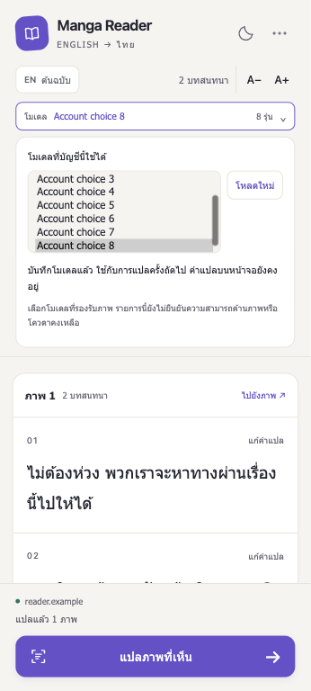
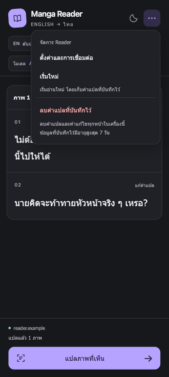

# Change models from Reader

## Connection/recovery and result labels follow-up (2026-10-29)

The three-PR [Settings follow-up](SETTINGS_PAIR_ONCE.md#connection-and-model-improvement-plan)
adds coordinated account/model writes, stale browser-form rejection, reconnect
recovery and categorized errors. The picker now says **แปลครั้งถัดไป**. Each
accepted image result displays its own model slug; changing the selection keeps
the existing result's label and unsaved edits. Model metadata persists alongside
cached dialogue and corrections, with the existing TTL, size and clear-data limits.
Legacy entries without metadata display **ไม่ทราบโมเดลที่ใช้**, retain their
dialogue, and are not relabeled using today's selection. Existing OAuth cache
fingerprints are retained; mock/demo results use a separate provider namespace.

The API binds result metadata to the selected profile and rejects account/model
changes during inference. The default mock path displays clearly marked generated
text and never sends the image to OpenAI. Real OAuth translation remains explicit.

Verification: 147 isolated mocked API tests, 115 extension regressions, all
extension JavaScript syntax checks, manifest JSON and diff checks pass. BrowserOS
neo exercised the actual Reader scripts with generated Chrome/provider data:
after one generated translation using A, selecting B retained A's result label
and the inference count stayed at one. At widths 280/360/480 px, the open picker
had no horizontal overflow and the translate action remained visible at 640 px
height. Generated reconnect Settings exposed the primary reconnect action.
These previews do not certify the installed extension or live OAuth; those
acceptance checks remain pending and the PRs remain Draft.

Implemented 2026-10-28, stacked on Settings PR #10. This adds a model control to
the Reader header without changing the Reader roadmap milestone order.

## Workflow

1. Open Reader. After checking the saved selection and management pairing, the
   panel automatically loads the connected account's current model catalog.
   The model row shows its display name and the number of available choices.
   This metadata load does not submit inference or change the selected model.
2. Open the model row to use the already loaded account choices. Choose one in
   the inline list; it saves immediately after the backend acknowledges it. A **โหลดใหม่**
   button refreshes the list. Escape closes the picker and focuses its summary.
3. Existing dialogue, corrections and an unsaved editor remain in place. Selecting
   a model does not submit any images, clear cache or automatically retranslate.
4. The next explicit scan/retry uses the backend selection. Existing cache keys
   include the model, so that scan can retranslate visible images when their
   previous result is from another model. Returning to a previously used model
   may reuse its still-valid exact-input cache. Corrections remain associated
   with the original cached result; they are not silently transferred to a
   different model's output.

The selection is global to this local, single-user gateway. Another Reader or
the local Settings page can change it. Focus refreshes the status and account
catalog while the chooser is closed; the **โหลดใหม่** button refreshes it explicitly. Opening an already
loaded picker reuses those choices without another provider request. Focus
returning to an open chooser keeps its options enabled and attached. Slugs are
shown until the account catalog supplies their display names. No speed, quality, vision-support or remaining-quota badges are
invented from incomplete catalog metadata.

## Busy and error behavior

- A running Reader queue disables selection/reload. Starting translation closes
  the picker so it does not cover dialogue; reopening shows why it is locked.
- A model save disables scan, retries, permission grants and cache clearing in
  that panel until it finishes. Reset/navigation cannot unlock an in-flight save.
- Failed or ambiguous saves never claim a new model was selected. The header
  asks to verify the model, and reloading obtains the actual saved value before
  another selection. Dialogue remains visible; no automatic retries are sent.
- Catalog failures and empty catalogs offer reload and Settings access. Legacy
  reader-only pairing can still read/translate but needs explicit management
  pairing to list or change models. Revoked credentials cannot change selection.
- Each queue carries the first validated result's opaque translation profile
  into subsequent image requests. If settings change elsewhere, the worker
  rejects the mismatch before inference/cache reuse and stops the queue. An
  in-flight HTTP 409 also stops remaining submissions. Unsent queued images
  become visible errors; use their explicit retry buttons when ready.
- Reset/navigation still discards obsolete results. Already submitted provider
  inference may complete and consume usage; this feature does not cancel it.

## Authority and concurrency

`GET /api/v1/settings/models` and `POST /api/v1/settings/model` require the separate
management capability issued by pair-once setup and a valid extension Origin.
The local pairing credential never contains an OpenAI token. Chrome permissions,
origin scope, inference admission and image limits remain unchanged.

Catalogs include an opaque version of the account identity, permissions and
selected model. Saves revalidate membership, account/version and current
management authority immediately before writing, after the provider round trip.
A stale choice gets HTTP 409 rather than overwriting a newer Settings choice.
Token refresh alone does not invalidate the version. All of this retains the
single-worker local POC assumption.

## Verification

- Mocked API suite: **121 passed**, one existing dependency deprecation warning.
  New checks cover management-only access, forbidden origins, catalog privacy,
  successful selection/profile invalidation, stale/concurrent account changes,
  revocation during provider I/O and token-refresh stability. The isolated test
  container has networking disabled and fresh temporary credential storage.
- Extension wiring and behavior/cache/Settings regressions: **103 passed**,
  including 21 model/queue/automatic-loading/control regressions. They cover retained dialogue/unsaved edits,
  no automatic inference, mutual exclusion, save failures, legacy/revoked
  credentials, initial-load races, cross-panel profile changes and HTTP 409 queue
  stopping. Syntax, manifest JSON and diff checks pass.
- BrowserOS neo ran the real Reader, worker, cache and model-picker scripts with
  generated Chrome/provider/image data. Switching models kept the displayed
  dialogue and inference count unchanged at one. Pending save disabled scan;
  pending inference disabled model selection; both recovered after completion.
- Widths 280/320/360/480 px at 640 px height, including maximum 25 px Thai text:
  no document horizontal overflow, the picker stayed within the viewport and
  the translate button remained visible. Escape returned focus to the summary.
  Light/dark screenshots contain generated dialogue and model names only.
- These previews do not establish installed Chrome extension behavior, real
  account model availability, vision compatibility or live translation quality.
  Keep the stacked PR Draft until actual Chrome acceptance and review.

| Inline model choices | Reader actions |
| --- | --- |
|  |  |

## Actual Chrome acceptance

1. Update this feature branch's gateway with `docker compose up --build -d api`;
   reload the unpacked extension and reopen Reader. Complete management pairing
   from Settings if the existing credential is reader-only.
2. Open the model row and choose an account model that supports images. Confirm
   save feedback and no automatic translation. Retry list loading on failure.
3. With dialogue visible, start an edit, change models and verify the draft is
   retained. Save/cancel the edit, then explicitly translate and verify the new
   model is used. Reopen the panel to confirm the backend selection is retained.
4. Confirm selection is disabled while translating and translation is disabled
   during model save. Reset during save must not start an overlapping scan.
5. Change the model from another Settings tab while a multi-image queue is
   running. Confirm the current conflicting result is rejected and remaining
   inference stops, with visible retryable errors. Earlier accepted results stay.
6. Test stale selection, permission revocation, gateway offline and a narrow
   panel with large Thai text. Do not include credentials or callback URLs in
   reports. Review and merge remain explicit human actions.

## Account-options follow-up

The startup-loading regression was reproduced before the change: the header
still showed only the saved slug, with no catalog request until the picker was
opened. It now preloads every returned displayable choice, preserves provider
order and shows the count. Catalog errors offer explicit reload; disconnected
accounts and reader-only pairing do not automatically query the provider.

On 2026-10-28 a read-only check of the connected local account's official catalog
returned HTTP 200 and eight displayable choices. The existing selected model
was retained, and no inference was submitted. Account model names, credentials
and the raw live response were not copied into fixtures. Automated completeness
checks use eight generated model entries plus hidden entries instead.

The display filter remains `visibility == "list"`, as specified by
[OpenAI Docs: Models and inference](https://developers.openai.com/siwc/token-sharing-open-source/models-and-inference).
Models hidden by the account catalog are not exposed as selectable choices, and
no global/static list is used to invent account entitlement.

The running gateway already exposes the required model endpoints. Reload the
unpacked extension and reopen Reader to load the automatic account choices.

BrowserOS neo also verified the automatic-loading follow-up using eight
**generated** account choices: all eight options were present before opening the
picker, the count matched, and no inference was submitted. The count/selection
controls fit at 280/360/480 px with the translate action visible. This is UI
verification with generated data; the separate read-only backend check above
establishes the live account catalog count.

## Focus and overlapping-menu correction

The reported unclickable selector reproduced in three regressions before the
fix: returning focus to an open chooser disabled the select and detached its
options; an idle render recreated option nodes; both Reader disclosures could
remain open. Browser hit testing confirmed that the model summary/panel covered
Settings, reset and clear-data buttons in the actions menu.

Focus now refreshes account metadata only while the model section is closed.
Explicit reload remains available inside it. Ordinary control updates retain
option elements unless the actual catalog/placeholder changes. Existing
translation/save/authentication gates still disable selection when required.

The chooser uses an inline, scrollable single-select list (`size=5`) rather than
a nested operating-system popup. Its section stays in document flow, above the
reading area. Opening either header disclosure closes the other, and Reader
actions have an explicit stacking order above the rest of the header.

BrowserOS neo clicked an actual visible option to save a new generated model,
then used ArrowDown and End to choose further models. The saved label/value
changed and inference stayed at zero during selection. Returning focus kept
the options attached/enabled without new requests. Settings received a real
pointer click, and hit testing reached Settings/reset/clear-data at widths
280/320/360/480 px. The inline choices did not overlap the reading area; no
horizontal overflow occurred and the translate action remained visible,
including 25 px Thai text. Screenshots use generated data only.

The three previously failing control regressions now pass within the 103-test
extension suite. The 121 mocked API tests, JS syntax, manifest and diff checks
pass. Actual installed Chrome acceptance still requires reloading the unpacked
extension and reopening Reader. The gateway and existing pairing do not change.

## Model loading interrupted by a Reader queue

Starting translation before the initial account-status response returned could
leave the chooser with only a disabled placeholder. The status response tried
to load the catalog during the active queue; that work was discarded, and queue
completion only repainted the empty control. Pairing changes during translation
could similarly clear the catalog without resuming the account check.

The picker now remembers deferred status/catalog work and resumes it when Reader
becomes idle. Status checks take priority and read the current credentials before
loading choices. Revoked pairing stays disabled without querying the provider
with old authority. Ordinary failed catalog requests still require explicit reload.

The startup regression failed before the fix (`1 !== 2` options) and passes after
it. Three new regressions cover interrupted startup plus replaced/revoked pairing
during translation. All 118 extension regressions and 147 isolated mocked API
tests pass; all extension JS syntax, manifest JSON and diff checks pass.

BrowserOS neo reproduced the same sequence with real Reader scripts and generated
Chrome/provider data: before the fix, zero catalog requests and a disabled
placeholder; after it, one catalog request and eight enabled choices. Selecting
the last choice saved it successfully while the inference count stayed at one.
This verifies the generated-data UI flow; installed Chrome acceptance is pending.
Reload the unpacked extension from this checkout and reopen Reader to try it.
