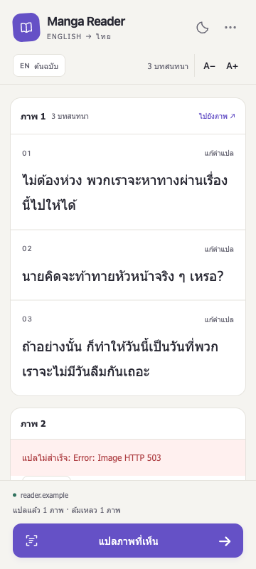

# Reader Side Panel redesign

The Reader now prioritizes Thai dialogue in a narrow reading column. The previous
header mixed translation, reset, settings and deletion actions at equal weight;
dialogue was nested in repeated cards with English always displayed.

## Layout

```text
Compact identity                  theme / menu
Original English toggle          count / A− A+
─────────────────────────────────────────────
Scrollable reading area
  Image heading: image number / count / locate
  Dialogue 01                         edit
    Thai translation
    Optional English source
  Dialogue 02                         edit
    Thai translation
  Per-image error / explicit retry
─────────────────────────────────────────────
Source website / concise status
Translate visible images (always reachable)
```

- Warm light theme by default, with a dark theme for low-light reading. The
  display controls retain theme, English visibility and Thai font size locally
  in `mangaReaderAppearance`; they do not submit translation requests.
- Thai text defaults to 19 px with adjustable 16–25 px sizing and generous line
  height. English is hidden by default and can be shown for comparison without
  translating again. Dialogue numbering and source-image labels stay visible.
- The main area scrolls independently while header and bottom action dock remain
  in view. Image groups use one surface with separators between dialogue rows.
- Settings, **เริ่มใหม่** and **ลบคำแปลที่บันทึกไว้** live in the top-right menu.
  Menu copy explains reset versus deleting saved corrections. Actions close the
  menu; Escape closes it and returns focus to its summary.
- The editor sits inside its dialogue row, with named textarea, save/cancel
  controls and a local error message. Saving still waits for durable storage.
- Status announcements use a polite live region; toggles expose their pressed
  state, controls have keyboard focus outlines, and animation respects reduced
  motion. Long dialogue/errors wrap within the panel. Assets and fonts do not
  require additional network requests or Chrome permissions.

## Preview

These 360 × 800 screenshots use generated dialogue and mock Chrome APIs, with
an intentional image-fetch error to show that failure remains visible.

| Thai reading / light | English comparison / dark |
| --- | --- |
|  |  |

## Verification

- BrowserOS neo checked widths 280, 320, 360 and 480 px at 640 px height, including
  maximum 25 px Thai text: no document horizontal overflow and the translate
  button remained within the viewport.
- At 280 px the menu stayed within the panel and Escape closed it. The editor
  also fit within the viewport, and an edited translation saved successfully.
- Light/dark rendering, English visibility, empty/loaded/error states and cache
  reuse were inspected using the real panel/worker/cache scripts with generated
  data. This preview does not certify actual installed Chrome Side Panel E2E.
- Wiring plus 59 behavior/cache regressions pass. New tests cover appearance
  controls without inference, safe bounds/restoration, invalid stored values,
  empty-state/count updates and menu reset without data deletion. API regression
  suite: 84 passed. JavaScript syntax and manifest checks pass.

Reload the unpacked extension to try the new layout. Actual Chrome acceptance
of this redesign remains pending; keep its PR Draft until that check. This is
stacked on the persistent-cache branch and changes no translation pipeline,
permission manifest or backend code.
