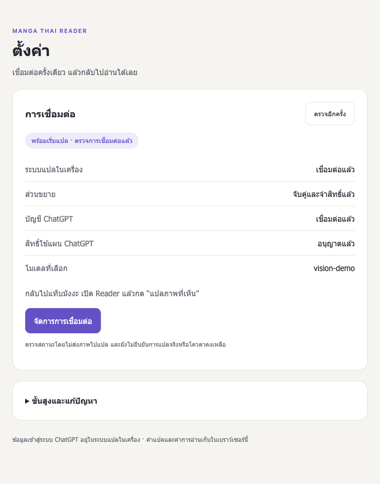
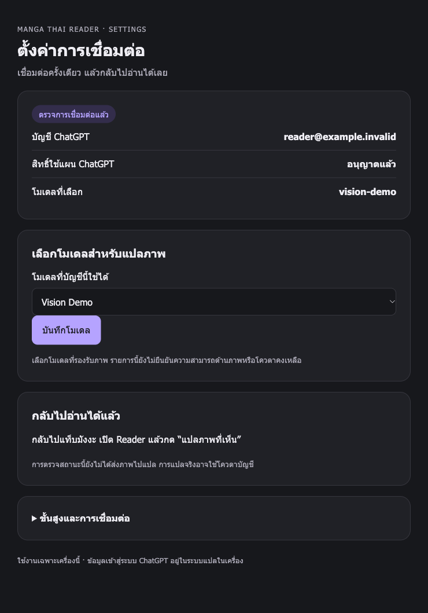

# Settings: pair once

Implementation plan, 2026-10-28. This work is stacked on the Reader panel branch;
the Reader roadmap order is unchanged.

## User journey

1. Start the existing local gateway. In the terminal run
   `docker compose exec api python -m app.local_security pair`.
2. Enter the short-lived code in Extension Settings and explicitly allow this
   extension to translate and manage the local ChatGPT connection.
3. Open connection settings from the extension, connect ChatGPT and select an
   available model from a dropdown. No model slug copying or normal admin-key
   entry is required.
4. Return to Settings to see gateway, pairing, account permission and selected
   model state. Refresh on focus without submitting inference.

## Implementation steps

- [x] Add local CLI pairing with explicit management consent and separate reader
  and management credentials. Preserve legacy reader-only pairing.
- [x] Exchange the management credential for a short-lived, single-use session
  ticket. POST the ticket from an extension launch page; never put credentials
  or tickets in URLs. Keep HttpOnly sessions, CSRF and Host/Origin checks.
- [x] Bind management browser sessions and tickets to the current pairing so
  re-pair/revoke also invalidates previously opened management sessions.
- [x] Replace raw JSON and equal-weight actions with Thai status, next steps,
  inline errors, model selection and advanced/recovery sections.
- [x] Cover consent, expiry/replay, origin checks, revocation, old credentials,
  storage/network failure and UI state with deterministic tests.
- [x] Run the mocked API suite, JS syntax and extension regressions; inspect
  generated-data UI in BrowserOS neo.

Delivery: a Draft PR stacked on Reader panel PR #9; never merge automatically.

## Security and recovery

The terminal is the initial owner authorization boundary. Generating a code does
not revoke existing pairing; redeeming a new code replaces the single paired
extension. Codes expire after ten minutes. Management credentials remain inside
trusted extension storage and never contain OpenAI credentials. Existing
translation credentials do not gain management authority.

Remembered management authority means access to this trusted extension profile
can manage the local account connection. This is an explicit grant during
pairing. The POC remains local, single-user and single-worker. CLI `pair` is the
recovery path after reinstall or loss of browser storage. Legacy admin unlock is
retained under recovery during migration.

Provider model metadata does not establish vision support; show a clear hint
without inventing a compatibility badge. Status checks do not prove inference
works or consume a test translation. Real Chrome/OAuth acceptance remains a
separate check from mocked tests and browser previews.

## Session handoff

The extension stores distinct opaque `mangaCapability` (Reader) and
`mangaSettingsCapability` (management) values in trusted `chrome.storage.local`.
The backend persists only their hashes in one capability record. Reader-only
legacy codes remain reader-only even if a client requests management authority.

Opening management launches an extension-owned tab, which exchanges its
management bearer at `/api/v1/settings/ticket` for a one-use ticket (60-second
expiry, at most 32 pending). The backend keeps a hash of the ticket and binds it
to the issuing extension origin and pairing generation. The launch page POSTs
it to `/auth/extension-session`; neither bearer nor ticket goes into a URL.
The handoff rotates the browser session and establishes an HttpOnly, SameSite=Lax
cookie. All owner mutations still require same-origin context and session CSRF.
The launch page uses an origin-only referrer policy to retain its form POST
Origin; OAuth callbacks and sensitive responses keep `no-referrer`.

Pair-issued browser sessions expire after 30 minutes and do not survive gateway
restart. Reopening from the paired extension creates a fresh session without
another code. Re-pair/revoke invalidates its old credentials, tickets and browser
sessions on subsequent requests. Existing admin-key recovery sessions retain
legacy behavior; resetting an admin key still requires restarting the API.

Unpair first revokes backend authority, then forgets both local credentials.
If the backend cannot be reached, local-only forgetting is a separately named
action that explains remote authority and already-open sessions remain until
revocation/re-pair or expiry. Neither action deletes saved dialogue, appearance
preferences or the ChatGPT account connection. A failed storage write after
redemption is reported as incomplete setup and requires a newly generated code.

## Verification

- Full mocked API suite: 107 passed, with one existing dependency deprecation
  warning. Runs in the existing test image with networking disabled and a fresh
  temporary auth directory; the real credential volume is never mounted.
- Extension wiring plus 82 behavior/cache/Settings regressions pass, including
  23 new Settings/launch tests. All extension JavaScript syntax, manifest JSON
  and `git diff --check` pass.
- BrowserOS neo used the real Options HTML/CSS/JS with a generated-data Chrome
  API shim: pairing enabled management, reload retained it, and status checks
  sent no inference. The model dropdown was exercised. Options, locked settings,
  model settings and catalog-error layouts had no horizontal overflow at
  280, 360 and 740 px. Light/dark previews use generated account/model data.
- This preview does not certify installed-extension Origin serialization,
  top-level POST/cookie handoff, Chrome storage lifecycle or live OAuth. Keep
  the PR Draft until real Chrome acceptance and security review. Existing
  Reader/cache manual acceptance does not cover this new flow.

| Remembered connection | Model settings / dark |
| --- | --- |
|  |  |

[First-time pairing preview](assets/settings-onboarding.png).

## Actual Chrome acceptance

1. Update the gateway with `docker compose up --build -d api`, reload the unpacked
   extension, and open Options. Existing reader-only pairing should still work
   for translation and offer explicit re-pairing for management.
2. In your own terminal run `docker compose exec api python -m app.local_security
   pair`; enter the displayed code and explicitly grant management permission.
   Do not paste codes, credentials or OAuth callback URLs into bug reports.
3. Open **จัดการการเชื่อมต่อ**. Confirm a new local Settings tab opens authenticated
   without admin-key entry or URL credentials. Connect ChatGPT if needed, choose
   an available vision-capable model and save. Returning to Options refreshes
   its status automatically.
4. Restart the gateway and the extension worker, reopen Options and management.
   Pairing should persist; an expired browser session should reopen without a
   new code. This setup does not itself submit a translation.
5. Leave an authenticated Settings tab open, then revoke or re-pair. Its next
   account/model mutation must fail, and a previously minted ticket must not
   establish a session. Confirm saved translations and reading preferences stay.
6. Exercise wrong/expired codes, denied consent, gateway offline and local-only
   forgetting. Model-list errors should preserve the selected model.

Roll out or roll back extension and gateway together. A new pairing replaces the
single previously paired extension; reverting code does not restore an older
credential, so use a fresh pairing if needed. Do not expand origin permissions,
expose the gateway remotely or merge automatically.

## Connection and model improvement plan

Planned 2026-10-29 after reviewing `fix/reader-model-controls` at `afa1d66`.
This section is a plan, not an implementation or acceptance record. It covers
the connection/model follow-up requested by the user and preserves the Reader
milestone order in [the roadmap](POC_PLAN.md).

The review used the current repository implementation, generated credentials
and isolated tests. It did not establish which build is running in the user's
Docker service or installed Chrome extension. The recorded baseline is 121 API
tests, 103 extension tests and passing extension JavaScript syntax checks.

### Delivery sequence

Use three dependent feature branches and Draft PRs, based on the current Reader
model-controls stack. Each PR includes its own regression tests and documentation.
Keep the single local user and single backend worker assumptions. Merge remains
a human action.

| Order | Suggested branch | Scope | Depends on |
| --- | --- | --- | --- |
| 1 | `fix/settings-account-model-consistency` | Credential write coordination; Settings save authority/version checks; deterministic mock default | Current model-controls branch |
| 2 | `fix/settings-connection-recovery` | Terminal refresh recovery; safe error categories; Thai next actions; queue stopping | PR 1 |
| 3 | `feat/reader-translation-model-labels` | Next-translation model wording; per-result model provenance and cache compatibility | PR 2 |

### 1. Make account and model writes consistent

Primary files: `apps/api/app/siwc.py`, `siwc_store.py`, `oauth_routes.py`,
`settings_ui.py`, `main.py`, `reader_vision.py`, `docker-compose.yml` and
`.env.example`. Update README setup instructions with the resulting defaults.

- Introduce one coordinated credential mutation boundary. Keep token-refresh
  network I/O outside short synchronous write sections; retain refresh
  serialization. Before committing a refresh response, verify that the account
  and credential generation still match the request that started it. Merge
  refreshed token fields into the latest matching record, retaining a model
  selected while refresh was pending. Do not restore an older account after
  sign-in or logout. Protect against disconnect/reconnect of the same identity,
  not just a different subject. Keep internal generations and tokens server-side.
- Use the same boundary for validated OAuth callbacks, logout and model writes.
  Recheck the initiating Settings authority after provider I/O before committing
  an account/model mutation. A revoked or replaced pairing must not regain
  authority through a late result. Token rotation alone must not invalidate an
  otherwise current model selection version or translation cache profile.
- Include an opaque selection version in the server-rendered Settings model
  form. Bind the catalog, selected model and version to one consistent account
  snapshot. Pass the submitted version and a final authorization check into
  `select_model`, matching the Reader endpoint. Missing/stale versions must not
  write; show a Thai HTTP 409 recovery page for a stale selection. Recheck session
  expiry, pairing generation and CSRF immediately before the write.
- Restore `mock` as the API and Compose default. Centralize provider resolution
  so status, translation, Reader and cache identity agree. Explicitly route the
  Reader mock path before OAuth inference: changing only `translate_texts` is
  insufficient because `translate_image` currently calls `auth.infer` directly.
  Use clearly marked generated demo output and never present it as real Thai
  translation. An explicit `TRANSLATOR_PROVIDER=chatgpt_oauth` still enables the
  real flow. Changing providers must not reuse another provider's cache entries.

Regression evidence required:

- Hold refresh A pending, complete sign-in B, then release A: B remains active.
- Hold refresh pending, acknowledge a model B save, then release refresh:
  model B remains selected and token fields are rotated together.
- A late refresh/callback cannot undo logout or write after its initiating
  management authority is revoked/replaced. Same-account reconnect is covered.
- Submit an old Settings form after another Reader/Settings choice: HTTP 409,
  newer choice retained. Revocation, re-pair or session expiry during catalog
  I/O prevents the pending Settings model save. Cover browser and extension
  routes, including successful saves and unchanged CSRF/Origin checks.
- With the provider environment unset, API/Reader requests never invoke the
  OpenAI transport. Explicit mock also makes no provider calls; explicit OAuth
  still uses the selected account/model. Provider changes invalidate cache reuse.

### 2. Make recovery actionable

Primary files: `siwc.py`, `oauth_routes.py`, `settings_ui.py`, `main.py`,
`apps/extension/options.js`, `reader-models.js`, `background.js` and
`reader-panel.js`.

- Classify documented terminal refresh failures separately from transient
  network/provider failures. For a terminal failure, invalidate only the
  matching unusable token generation, retain the saved registration identity,
  and report that reconnection is required. A late failed refresh must not clear
  a newly connected account. Network failures preserve credentials.
- Give Settings and Options consistent connection states: not connected,
  connected without plan permission, reconnect required, no model selected,
  configured without a live inference check, and temporarily unavailable.
  Promote reconnect to the primary action when required. Reauthorization uses
  the saved issued client ID; permission recovery must be checked against
  official OpenAI guidance before implementation.
- Add a safe, stable application error code and recovery action for auth,
  permission, usage limit, unsupported image/model capability, temporary
  availability and unknown failures. Preserve useful upstream status/code and
  request ID in sanitized diagnostics. Never return raw provider bodies,
  credentials or user dialogue in errors/logs. Do not treat every HTTP 400 as
  evidence that a model lacks vision support.
- Carry safe error categories through the worker to Thai UI messages. Stop
  unsent queue items for account-wide auth/permission/usage failures and an
  incompatible selected model, with a visible reason and explicit retry after
  recovery. Preserve ordinary per-image failure handling. Do not automatically
  resubmit inference or silently change account, model or billing path.
- Keep the account catalog's server order and display names. Do not infer vision
  support, remaining quota, quality or speed from a model name or catalog listing.

Regression evidence required:

- A terminal refresh failure changes status and presents reconnect; a network
  timeout or temporary upstream failure keeps the saved credentials intact.
- An old generation's failure cannot disconnect a newer connection.
- Missing plan permission, usage limits and unsupported capability each offer
  the correct next action without leaking provider payloads or secrets.
- Relevant global failures stop remaining inference submissions; ordinary
  image-specific failures still allow independent images to proceed.
- Opening Settings, refreshing status/catalog and changing models submit zero
  inference requests. Existing explicit retries and ambiguous-save handling work.

References: [OpenAI registration and sign-in](https://developers.openai.com/siwc/token-sharing-open-source/sign-in),
[models and inference](https://developers.openai.com/siwc/token-sharing-open-source/models-and-inference),
and [errors and recovery](https://developers.openai.com/siwc/token-sharing-open-source/errors-and-recovery).
Recheck these official sources when implementing provider-specific behavior.

### 3. Distinguish selection from displayed results

Primary files: `reader-models.js`, `reader-panel.js`, `background.js`,
`reader-cache.js`, Reader HTML/CSS and the backend Reader response contract.

- Label the picker as the model for the next explicit translation. Explain after
  a successful save that displayed dialogue retains its original source model.
- Attach a safe model identifier to each accepted translation response, bound to
  the same validated account/model profile used for that request. A conflicting
  in-flight response must still be rejected rather than relabeled with the
  current selection. Do not attach email, account ID or credentials.
- Persist and display result provenance through the cache's existing whitelist.
  Preserve user corrections, expiry, size limits and clear-data behavior. A
  cached result retains its originating model after selection changes or worker
  restart. Show an unknown-origin label for legacy entries lacking provenance;
  do not infer their model from today's selection or force paid retranslation.
- Keep existing dialogue and unsaved edits visible on model changes. Switching
  models alone must neither translate nor clear cached data.

Regression evidence required: mixed A/B results display their own model;
returning to A can reuse valid A results; cache reload and edits retain provenance;
legacy entries remain readable; reset/navigation and changed-profile rejection
still discard obsolete replies; Thai controls fit narrow panels and remain
keyboard accessible.

### Verification and actual-browser acceptance

For every PR, run the full API suite in the isolated test image with networking
disabled, temporary credential storage and the current source mounted. Run
`node apps/extension/test-sidepanel-wiring.cjs` (the existing entrypoint includes
all extension behavior suites), syntax-check every extension JavaScript file,
validate manifest JSON and run `git diff --check`. Add targeted regressions for
each fix; avoid counting the same extension tests twice through overlapping
entrypoints. Check UI layouts with generated data at 280/360/480 px, large Thai
text and light/dark appearance.

Before recording actual acceptance, establish which source build is running in
Docker and reload the unpacked extension from the matching checkout. Record the
commit/build evidence and test result, excluding account data and credentials.
Use BrowserOS neo for browser inspection where the installed extension can be
exercised; generated-data previews are separate evidence from installed Chrome.

Actual-browser scenarios: fresh/remembered pairing, reconnect after terminal
expiry, restart and Settings-session renewal, two-tab stale model selection,
revocation during a pending operation, gateway offline, and persistence of the
saved model. Then explicitly translate an authorized image, switch models and
translate again to check provenance and retained edits. Live sign-in/consent is
a human step; record live inference separately because it consumes plan usage.

Completion means each PR's regressions and full checks pass, the running-version
check is recorded, and actual Chrome acceptance has evidence. Missing live
acceptance remains an open item; mocked checks alone do not establish completion.
Keep each PR Draft until its required manual checks and review are complete.

### Implementation evidence (2026-10-29)

Backend implementation on `fix/settings-account-model-consistency` includes
coordinated credential writes, stale/unauthorized browser-form rejection,
terminal refresh recovery, explicit consent recovery and a real Reader mock
path. Safe error categories and validated result-model metadata are shared API
foundations for the next two extension PRs. Token rotation retains the latest
model; account/logout generations fence late operations. Existing OAuth cache
profiles remain stable, while mock uses a distinct profile namespace.

The new deterministic reproductions failed on the baseline in eight cases,
including model B reverting to A and revoked Settings saves returning success.
The isolated full API suite now passes 147 tests (one existing dependency
deprecation warning), with networking disabled and fresh temporary auth storage.
This is implementation/test evidence; installed Chrome and live OAuth acceptance
remain pending.
